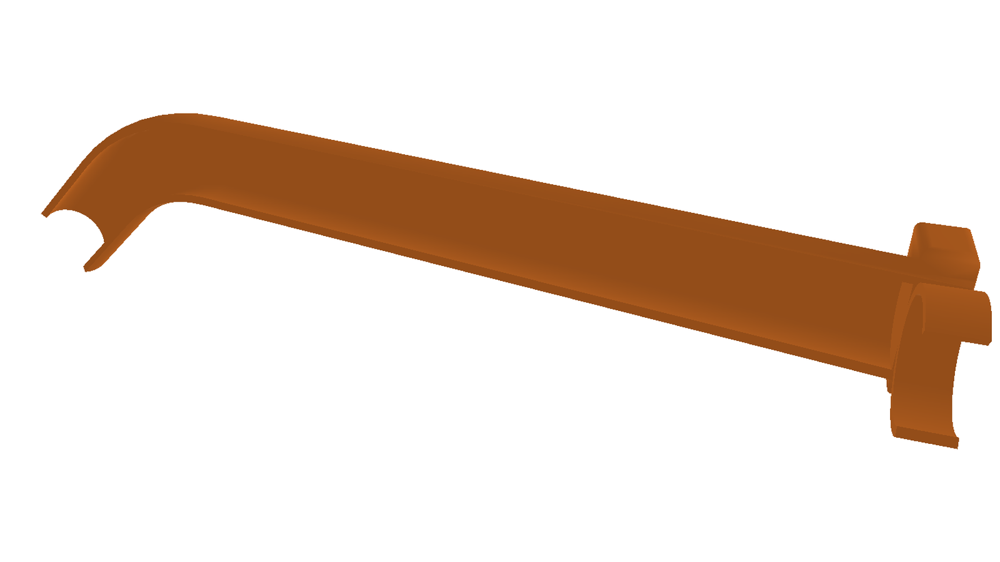

# 水管漏水引流器（Drain Diverter）

## 背景

家里的总水阀处有轻微漏水，不方便换阀，所以做了这个不碰水阀、不改管道的方案：一个 3D 打印件直接卡在管子上，把漏下来的水接住并从末端引走，滴到指定位置。

## 方案

夹在 24mm 水管上的 3D 打印件：C 形卡箍扣住水管、挡板拦住溅水、引水槽把漏水接住并导到末端，末端出水口向下弯，像水龙头一样把水引向前下方。

模型用 [build123d](https://build123d.readthedocs.io/) 参数化重建（原模型是 SolidWorks 手工建模）。所有尺寸集中在 `codes/引流模型.py` 的 `Params` 里，改参数即可出新版本，STL / STEP 由脚本生成，结果可复现、可编辑。



## 目录结构

```
.
├── codes/引流模型.py          build123d 参数化建模脚本（唯一几何源）
├── original/                  原始资料，只读参考，不参与生成
│   ├── 引流.SLDPRT            原始 SolidWorks 文件
│   └── 引流V1.0-20260913.STL  原始导出 STL（V1.0 实测版）
├── output/                    脚本生成的 STL / STEP
│   ├── V1.0/                  引流V1.0-build123d.stl / .step
│   └── V1.1/                  引流V1.1-build123d.stl / .step
├── images/                    渲染预览图
│   └── 引流V1.1-出水口.png     V1.1 整体预览（3/4 视角）
├── requirements.txt
├── .gitignore
└── README.md
```

## 使用

需要 Python 3.11（build123d 依赖 OCC，Windows 上用 `py -3.11` 建虚拟环境最省事）。

```bash
pip install -r requirements.txt

python codes/引流模型.py                # 生成 V1.0（复刻现有模型）
python codes/引流模型.py --ver v11      # 生成 V1.1（含下文全部修改）
python codes/引流模型.py --no-export    # 只打印尺寸/体积，不写文件
python codes/引流模型.py --out-dir D:\tmp   # 换输出目录
```

输出统一写到 `output/<版本>/引流<版本>-build123d.stl` 与 `.step`。STEP 可直接进 SolidWorks / Fusion 继续编辑。

注意：本机 OCC 直接往工作区写 STL 会静默失败，脚本内部先写临时目录再复制，属于预期行为。

## 坐标系

单位 mm，原点在头部挡板端面的左下角：

| 轴 | 含义                                                    |
| -- | ------------------------------------------------------- |
| X  | 沿引水槽轴线方向，0 = 头部端面（基准面），+X 指向出水口 |
| Y  | 横向，卡箍开口朝 +Y（+Y 侧是水管所在的一侧）            |
| Z  | 竖直，0 = 挡板底面                                      |

## 几何参数（V1.0，从原始 STL 反推）

| 部位     | 参数                                                                                                            |
| -------- | --------------------------------------------------------------------------------------------------------------- |
| 卡箍     | 内径 26、壁厚 3、外径 32、圆心 (Y 64.4, Z 16)、开口 107.9°（轴线偏 −3.8°）、沿 X 0→10                       |
| 挡板     | X 0→10、Y 35.93→50.93、Z 0→32、顶底与四个竖边共 8 条边 R2                                                    |
| 引水槽   | 外径 25.71、壁厚 2、开口 137°，轴线在 X=0 处 Y=49.11、Z=15.525，在 XY 面内相对 X 轴倾斜 −10°，沿轴线长 210.4 |
| 端面处理 | 起点被 X=0 平面切平；末端垂直于槽自身轴线切断                                                                   |

引水槽的截面是垂直于它自己轴线的（X 截面面积 ≈ 垂直截面面积 × 1/cos10°，实测 92.9 / 91.5 正好是 1/cos10°）。

## 版本记录

### V1.0 · 2026-09-13 打印

原始笔记（原 `readme.txt` 的内容，已并入本文件）：

- 水管直径 24mm，构造圆直径 24mm 充当水管
- 设计卡水管直径 26mm，实物 25.6mm
- 设计引水直径 24mm，但这里设计上没约束对，实际是 25.71mm；实物引水管外径 25.3mm

实测结论：卡箍内径做成 26mm 太松（当时想扩 2mm 方便安装），水管直接扣不住；卡箍壁厚 3mm 偏厚，没必要。

### V1.1 · 待打印

| 编号   | 修改内容                                    | 原因                                                     |
| ------ | ------------------------------------------- | -------------------------------------------------------- |
| 修改 1 | 卡箍内径 26 → 24                           | 26 太松扣不住，24 才贴合 24mm 水管                       |
| 修改 2 | 卡箍壁厚 3 → 2                             | 3mm 太厚，2mm 够用                                       |
| 修改 3 | 引水槽外径 25.71 → 24                      | 恢复设计意图的"引水直径 24"（原约束错导致 25.71）        |
| 修改 4 | 末端出水口下弯 45°（R50 圆弧 + 30mm 直口） | 斜向前下方，像水龙头出水口，避免水流向后乱淌             |
| 修改 5 | 引水槽总长 210.4 → 250                     | 加长，扩大接水范围（250 是沿轴线的总长，含弯折段和直口） |

V1.1 整体尺寸：包围盒 242.3 × 77.4 × 60.8 mm（Z 从 −28.8 到 32，出水口比挡板底面低 28.8mm），体积 26.36 cm³，单一实体。

调参建议：觉得出水口太深就把 `channel_bend_angle` 从 45 收到 35，或把 `channel_bend_radius` 从 50 放到 70；觉得不够"水龙头"就往 60 加。

## 校验

V1.0 重建与原始 STL 对比（原始 STL 只有 656 个三角面，圆弧按弦近似，本身略偏小）：

| 项目   | 原始 STL                    | build123d 重建              |
| ------ | --------------------------- | --------------------------- |
| 包围盒 | 208.073 × 74.652 × 32.000 | 208.022 × 74.738 × 32.000 |
| 体积   | 24.59 cm³                  | 24.84 cm³（+0.9%）         |
| 实体数 | 1                           | 1                           |

## 加新版本

在脚本里加一个预设即可，不用改建模逻辑：

```python
V12 = replace(V11, channel_bend_angle=60.0)
```

再在 `main()` 的 `--ver` 选项和版本名映射里加一条，输出会落到 `output/V1.2/`。

## 已知细节

- 卡箍开口不是对称的，实测为 −57.7° ~ +50.2°，所以参数里带了 −3.8° 的偏转。
- 挡板的圆角是顶面、底面 8 条边都倒 R2，不是只倒四个竖角。
- 引水槽末端是垂直于自身轴线的斜切口；V1.1 起改为经 45° 圆弧下弯后再留一段直口。
